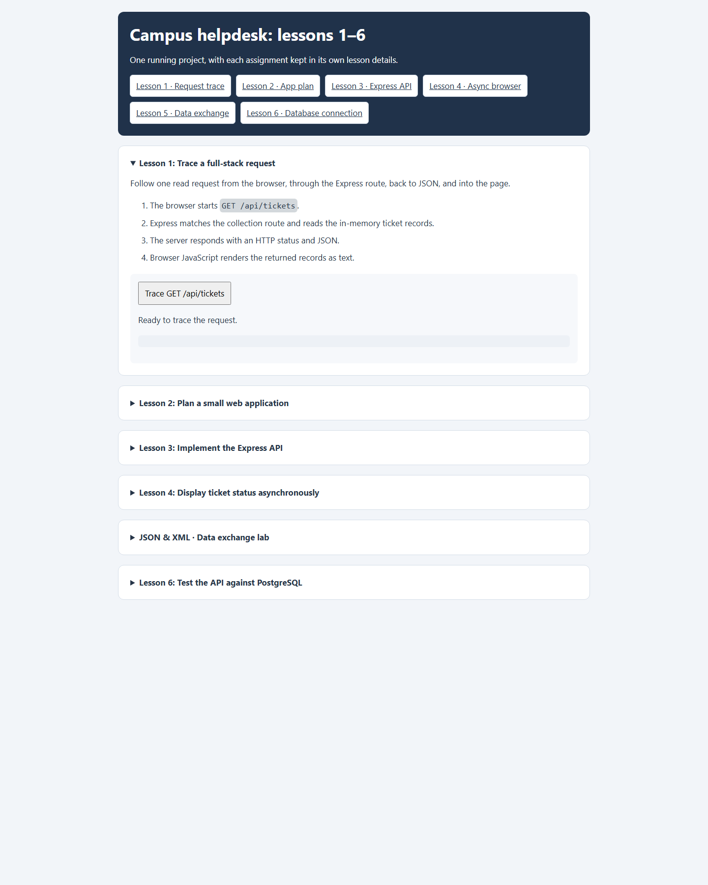

# Lesson 1: Trace a full-stack request



## Request path

The **Trace GET /api/tickets** activity sends a request from the browser and displays the HTTP status, returned ticket records, and a short response summary.

```text
Browser: public/lessons/app-01.js
  -> GET /api/tickets
Express: server.cjs mounts routes/tickets.cjs
PostgreSQL: routes/tickets.cjs queries the helpdesk database
  <- HTTP response with JSON
Browser renders the records as text
```

The app is no longer backed by the original in-memory sample array. The shared API uses the PostgreSQL pool in `db.cjs`; the collection route reads from the `"Ticket"` table unless a status or search filter is requested.

## Screenshot


## Inspect it

1. Start PostgreSQL and the app using the setup steps in the project README.
2. Open the lesson in the browser and select **Trace GET /api/tickets**.
3. Confirm the status is `200`, ticket records appear, and the summary reports a JSON array.
4. Open `http://127.0.0.1:6767/api/tickets` directly to inspect the raw JSON response.

The browser request is asynchronous: the page stays loaded while `fetch()` waits for the response. If the server returns an HTTP error, there is a status code; if the browser cannot reach the server, there is no HTTP response.

## Source map

- `server.cjs` creates Express, logs requests, serves `public/`, and mounts the ticket router.
- `routes/tickets.cjs` implements the API and queries PostgreSQL.
- `db.cjs` configures the PostgreSQL connection pool from environment variables.
- `public/index.html` contains the lesson activity and loads its browser script.

## Note about the lesson text

The on-page walkthrough still describes the collection route as reading in-memory records. That sentence is from the earlier version of the exercise; the running implementation now reads PostgreSQL.
