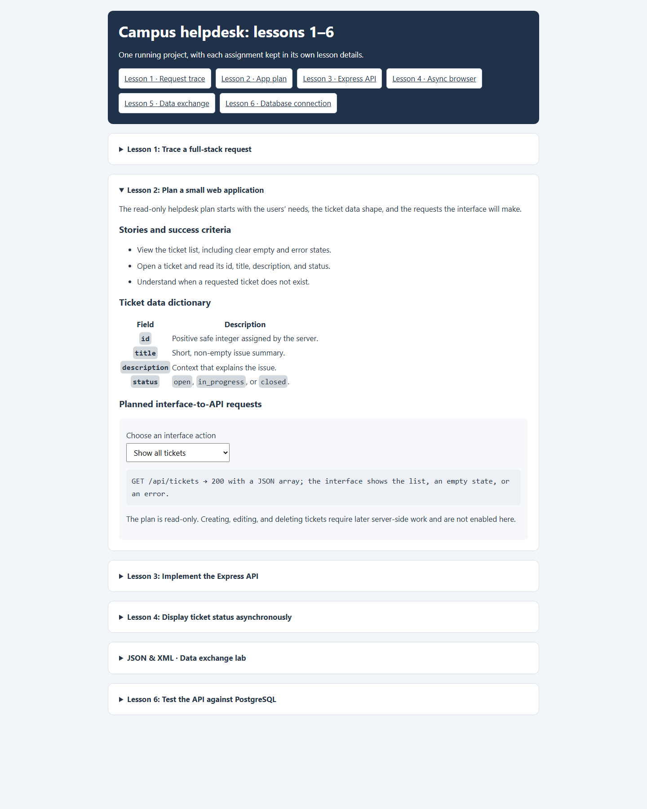

# Lesson 2: Plan a small web application

## Original scope

The initial plan describes a read-only helpdesk: list tickets, view a ticket, and communicate clear loading, empty, failure, and not-found states. Its user stories, ticket data dictionary, and request selector remain useful for learning how requirements map to an interface and an API contract.

The running project has since grown beyond that first scope. The shared API is PostgreSQL-backed and also supports create, update, close, delete, status filtering, and search. The lesson's plan is a snapshot of the original design, not a complete specification of every current feature.

## Planned user stories

1. List the tickets and understand an empty or failed list request.
2. View one ticket's id, title, description, and status.
3. Receive a clear not-found response for an unknown ticket.

The selector demonstrates the planned requests:

| Action | Request | Intended result |
| --- | --- | --- |
| Show all tickets | `GET /api/tickets` | Ticket array, empty state, or error state |
| Show ticket 1 | `GET /api/tickets/1` | Ticket details |
| Show an unknown ticket | `GET /api/tickets/999` | Not-found JSON error |

## Screenshot

## Data-model evolution

The original plan uses `id`, `title`, `description`, and `status`. Its status examples include `open`, `in_progress`, and `closed`. The current database instead defines `open`, `pending`, `resolved`, and `closed`; `in_progress` is not a valid database/API status.

When a plan and implementation diverge, record the difference explicitly and update the contract before using either version as the source of truth. The current API behavior is documented in the project README and enforced by `helpdesk.sql`.

## Planning takeaway

User stories describe outcomes; the data dictionary keeps interface and server field names consistent; and the request table makes the boundary between browser and API concrete. This early plan intentionally provides a smaller starting point than the final application.
