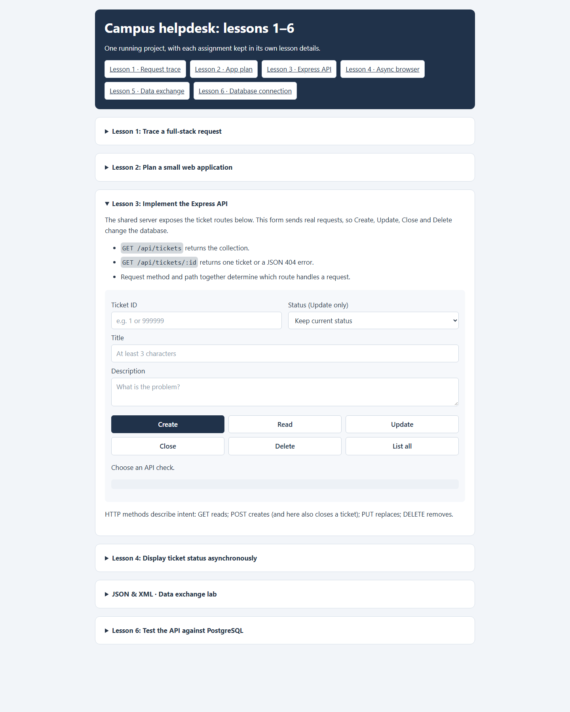

# Lesson 3: Implement the Express API

The Lesson 3 form sends real HTTP requests to the shared Express API. Read operations inspect the database; write operations can change its records.

## Available routes

| Method and path | Behavior |
| --- | --- |
| `GET /api/tickets` | List tickets; optionally filter with `?status=open` or search with `?search=printer`. |
| `GET /api/tickets/:id` | Return one ticket or a JSON not-found error. |
| `POST /api/tickets` | Create a ticket with a title and description; its initial status is `open`. |
| `PUT /api/tickets/:id` | Update title and description, optionally changing status. |
| `POST /api/tickets/:id/close` | Close a ticket through the status procedure. |
| `DELETE /api/tickets/:id` | Delete a ticket only after it is closed. |

The API returns the database primary key as `id`. Status values are `open`, `pending`, `resolved`, and `closed`. The database rejects invalid status transitions; a closed ticket must be reopened before it can be edited.

## Screenshot

## Explore safely

1. Use **List all** or **Read** to inspect existing tickets.
2. Use **Create** with a test title and description to see the generated id.
3. Try invalid input to inspect a structured `400` response.
4. Use **Update** to change the created ticket, respecting the allowed status workflow.
5. Close a test ticket before trying **Delete**; deleting a non-closed ticket is rejected.

The buttons send real requests. Avoid editing or deleting records you need to keep.

## Implementation details

`server.cjs` mounts `routes/tickets.cjs` at `/api/tickets`. The route handlers call PostgreSQL functions and stored procedures through the pool from `db.cjs`. The search keyword is passed as a SQL parameter rather than concatenated into the query. Errors such as invalid input, missing tickets, and forbidden status transitions are translated to HTTP status codes and JSON error objects.
