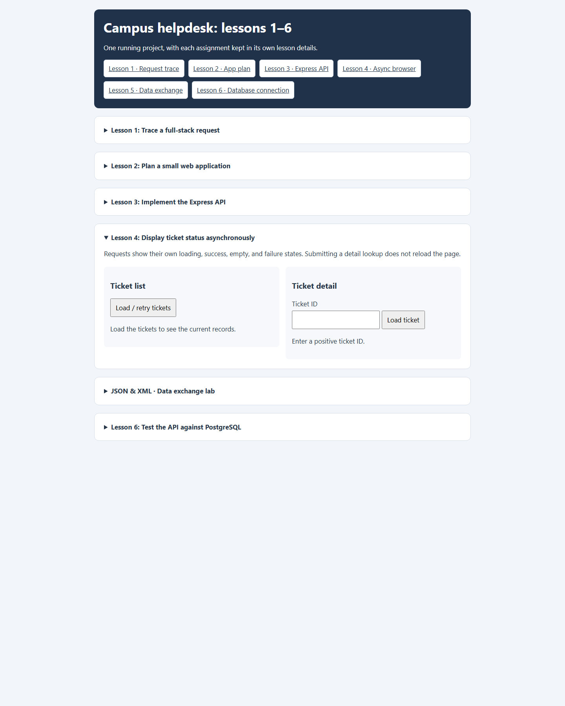
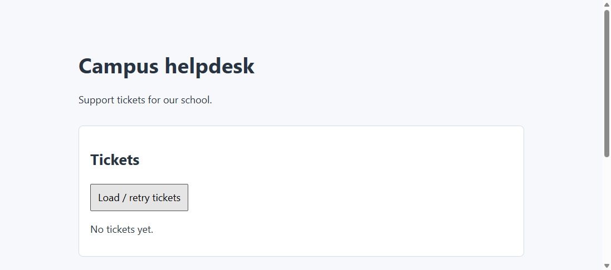
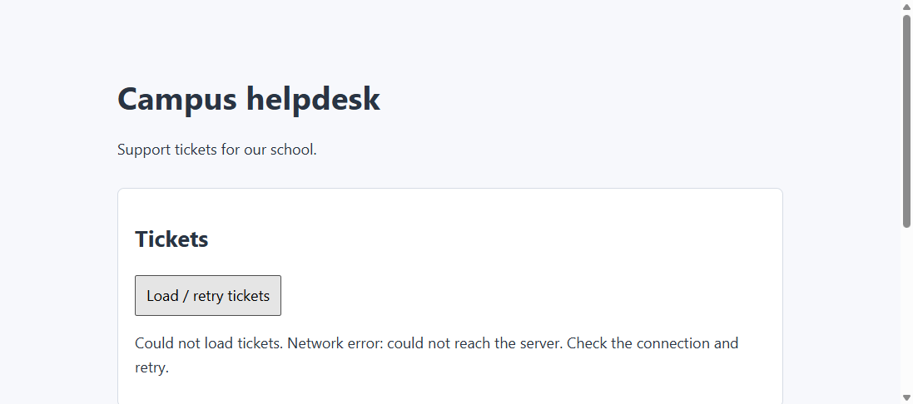
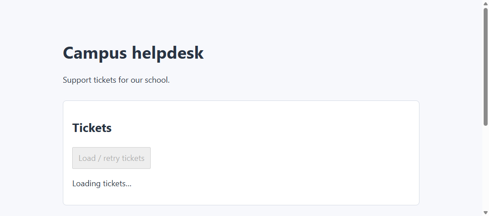

# Lesson 4: Display ticket status asynchronously



## How `fetch()` proceeds

`fetch()` starts an HTTP request and returns a Promise. JavaScript continues with synchronous work while the browser waits for the response. The response object contains the status and body stream; parsing it with `response.json()` is a separate asynchronous step.

```js
async function fetchTickets() {
  const response = await fetch('/api/tickets');
  if (!response.ok) {
    throw new Error(`Request failed with HTTP ${response.status}`);
  }
  return await response.json();
}
```

`fetch()` normally resolves even for HTTP errors such as 404, so check `response.ok` before treating the body as a successful result.

## Interface behavior

- **Load / retry tickets** requests the collection, checks its shape, and replaces the list.
- An empty array displays `No tickets yet.` rather than an error.
- The detail form prevents page navigation, validates a positive safe-integer ID before sending a request, and removes stale detail content.
- A 404 gets a specific not-found message. Network failures, invalid JSON, and unexpected response data are reported separately.
- The list and detail controls are disabled while a request is in progress and restored in `finally`, including on failure.

The screenshot shows the initial list and detail controls before a request is submitted. The available database records can change, so the list contents are not fixed examples.

## Screenshots





## Cases to try

| Case | Expected behavior |
| --- | --- |
| Load the collection | Show the returned tickets and a count. |
| Return an empty array | Show the empty state and no stale list items. |
| Load an existing positive ID | Show its title, description, and status without a page reload. |
| Load an unknown ID | Show a distinct 404 not-found message. |
| Enter `abc` or `0` | Show validation feedback without sending a detail request. |
| Stop the server, then retry after restarting it | Show a connection error, recover the controls, and allow a successful retry. |
| Return malformed JSON | Show a readable format error and restore controls. |

An HTTP 404 means the server responded and reported that the ticket is missing. A network error means the browser received no HTTP response. These are different failure modes and should have different messages.
