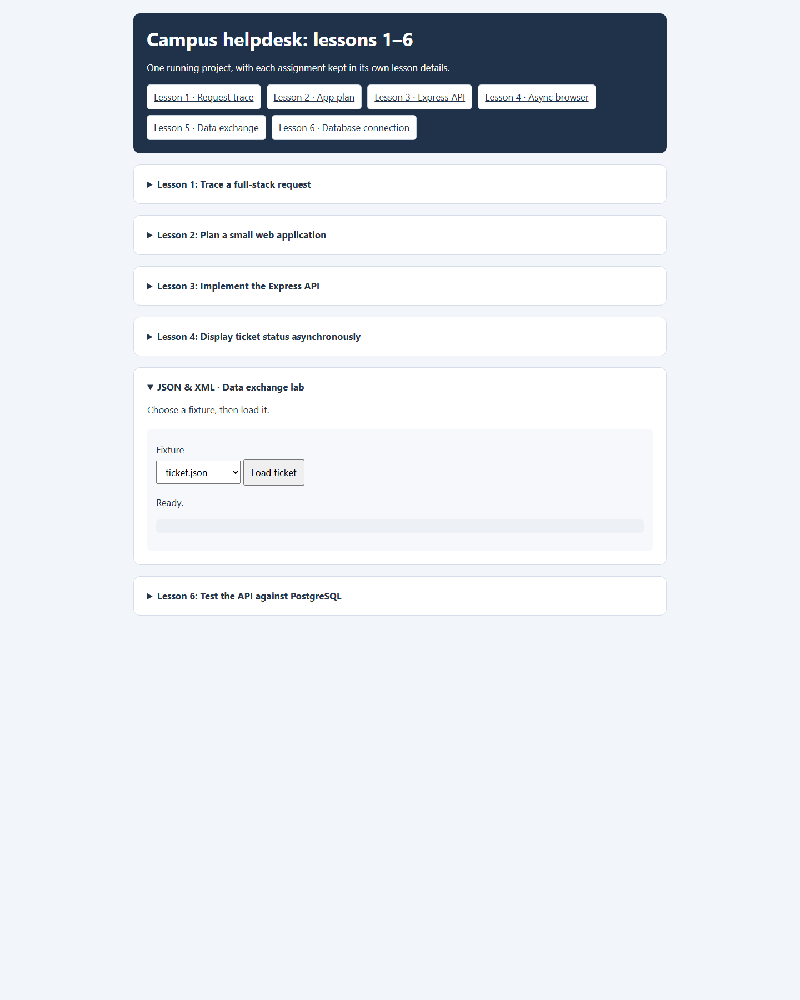

# Lesson 5: JSON & XML data exchange

The fixture loader requests one file from `public/data-exchange/`, parses JSON or XML, validates the resulting ticket, then displays the normalized object. It does not write to the helpdesk database.

## Try the fixtures

Choose a fixture and select **Load ticket**:

| Fixture | Purpose |
| --- | --- |
| `ticket.json`, `ticket.xml` | Valid example in each format |
| `my-ticket.json`, `my-ticket.xml` | Additional valid examples |
| `broken.json`, `broken.xml` | Malformed input / parser-error handling |
| `invalid.json`, `invalid.xml` | Well-formed data with an invalid ticket shape or value |
| `missing.json` | HTTP error handling for a fixture that is not present |

The loader disables its button while loading and displays parsing, structure, validation, and HTTP errors in the status area.

## Screenshot

## Ticket validation rules

Both formats are normalized to the same fields: `id`, `title`, `description`, and `status`. The browser validation requires a positive safe-integer id, a title from 3 to 100 characters, a description of at most 1000 characters, and a recognized status.

XML must have an unnamespaced `<ticket>` root with exactly one plain-text child for each required field. The parser rejects unknown, duplicate, missing, or nested ticket fields as well as malformed XML.

## Keep fixture and database contracts distinct

The fixture validator currently accepts `open`, `in_progress`, and `closed`. The PostgreSQL API uses `open`, `pending`, `resolved`, and `closed`. These are separate lesson contracts today; `in_progress` is not a valid database status. If the formats are intended to represent the live API model, align the fixtures and validator with the database status enum.
