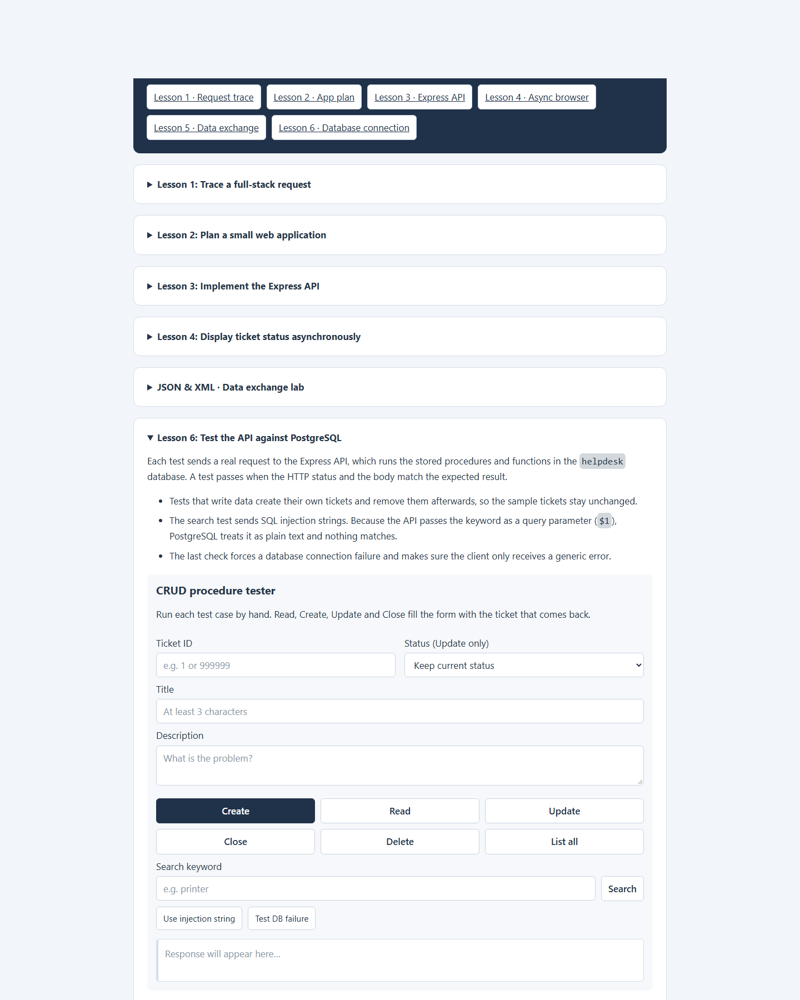

# Lesson 6: Test the API against PostgreSQL



The Lesson 6 tester sends requests to the running Express API and displays the request, HTTP status, and response body. The API calls PostgreSQL functions and procedures. Unlike the JSON/XML fixture exercise, some actions here mutate database records.

## Manual checks

- **List all** and **Read** inspect ticket data.
- **Create**, **Update**, **Close**, and **Delete** exercise the database procedures and status workflow.
- **Search** tests the optional `search` query parameter.
- **Use injection string** fills the search field with a SQL-injection test string; the API parameterizes the keyword so it is handled as text.
- **Test DB failure** checks that a database error becomes a generic server error without exposing connection or SQL details.

Use disposable records for write operations. Only closed tickets can be deleted. The status workflow is enforced in the database, so an invalid transition should be rejected even when sent directly to the API.

## Enable the failure test

The database-failure route is disabled by default. To enable it for this lesson, add the following to `.env` and restart the server:

```dotenv
ENABLE_TEST_ROUTES=true
```

The route intentionally creates a failed database connection; use it only for the test. The client should receive a generic `500` JSON error, not credentials, SQL text, or stack details.

## Screenshot


## What a passing check means

Check the response body as well as the HTTP status. Examples include a created ticket with a numeric id, an updated ticket with the expected status, and a successful delete with HTTP `204` and an empty body. The controls are manual API probes, not a test suite that automatically cleans up every record.
